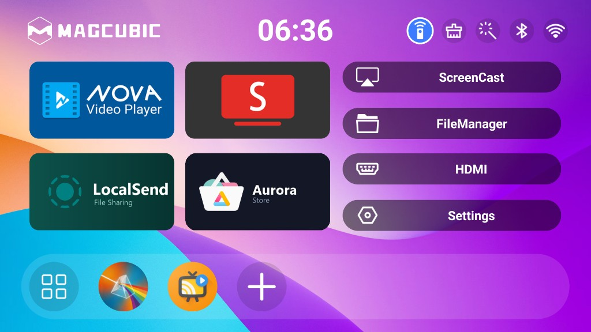
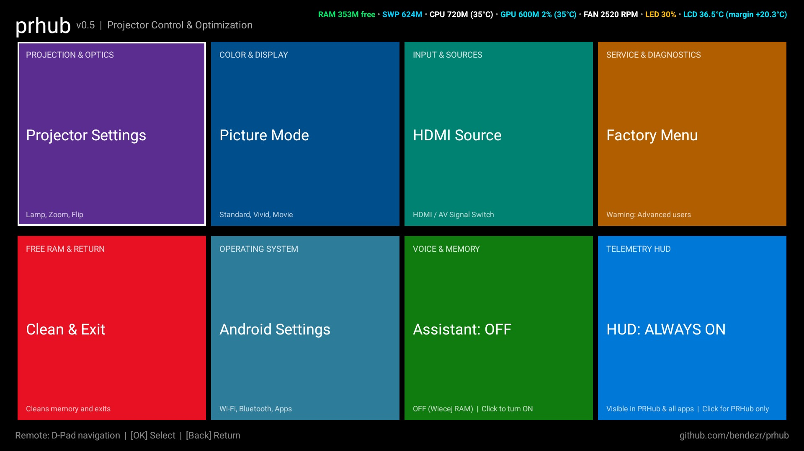
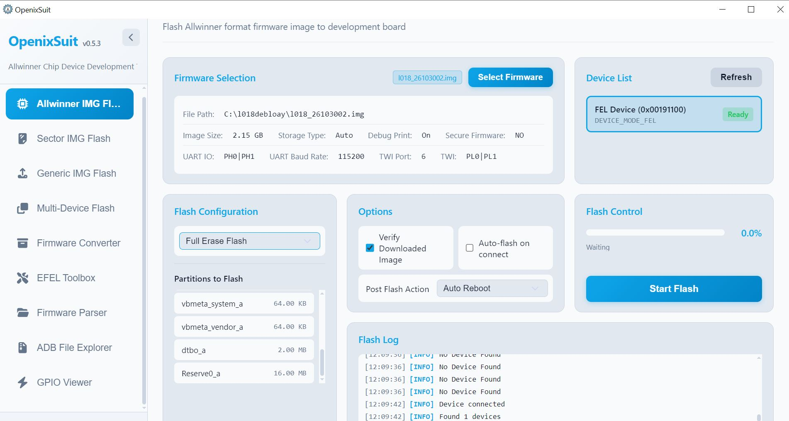

# Magcubic L018 – Custom Firmware & Optimization Guide

`Allwinner H726` • `Android 14 TV` • `1GB RAM / 16GB ROM` • `Build: l018_26110101.img`

> High-performance, debloated custom firmware and flashing guide for the **Magcubic L018** projector. Resolves critical RAM starvation (boosting free memory from ~20 MB to ~300 MB), eliminates adware/telemetry, and adds the custom **PRHub** controller with calibrated picture and audio profiles.

---

## 📸 Screenshots

| LuminaOS Desktop Overhaul | PRHub Control Center |
| :---: | :---: |
|  |  |
| *Streamlined desktop with SmartTube, Nova, LocalSend & Aurora Store* | *Proprietary system hub: live RAM meter, motorized optics, HDMI & cache flush* |

---

## 📥 Download Links

| Image Variant | Description | Direct Link |
| :--- | :--- | :--- |
| **Firmware with Root** | Cleaned stock system with pre-configured Root access | [Download from MEGA](https://mega.nz/folder/yYtCTaKR#1SRV57eHmnI-LdXAofpewQ) |
| **Firmware with Root + Optimizations** | **Recommended:** Complete debloat, PRHub, DSP audio, picture calibration & kernel boost | [Download from MEGA](https://mega.nz/folder/dMYElIqY#NARE4DKCwyzCbLF3I-F0Ew) |
| **Drivers**| **drivers.zip** Contains the official Amlogic USB burning mode drivers. Make sure to install them if your PC does not recognize the device when putting it into flashing mode. | [Download from MEGA](https://mega.nz/folder/dMYElIqY#NARE4DKCwyzCbLF3I-F0Ew) |
| **Flashing Utility** | OpenixSuit (Modern open-source flashing tool for Allwinner SoCs) | [OpenixSuit GitHub](https://github.com/YuzukiTsuru/OpenixSuit) |

---

## 🚀 Step-by-Step Flashing Procedure

1. **Download and install OpenixSuit** on your PC/laptop (Windows or Linux).
2. If your PC does not recognize the device, extract and install the drivers from drivers.zip (hosted on MEGA).
3. Launch the application and load the unpacked firmware image file (`.img`).
4. Connect the projector to your computer using a high-quality USB data cable.
5. Plug the projector's power supply into an AC mains outlet.
6. Using a thin tool (e.g., a toothpick or paperclip), **press and hold the RESET button** inside the pinhole located next to the USB port.
7. Press the **Power button** on top of the projector casing, then release the **RESET button**.
8. The projector will enter Allwinner download mode (**FEL Mode**).
9. Configure the flashing options in OpenixSuit as shown in the screenshot below and click **Start Flash**.

  

9. **Do not disconnect the USB cable or power supply** until the application displays the 100% success message.

> [!NOTE]  
> The very first boot after flashing takes noticeably longer than usual due to initial application unpacking and permission setup.

> [!WARNING]  
> **Flashing firmware is performed at your own risk!** If you are uncomfortable flashing custom system images, do not proceed — stay with the stock software or consider upgrading to a higher-end projector.

---

## 🛠️ Complete Technical Changelog (`Build: l018_26110101.img`)

### 1. 🧹 Deep Debloat & RAM Balance (Stock: 20–30 MB ➔ **Now: ~300 MB Free RAM**)
* **RAM Reserve:** Stock firmware booted with a critically low 20–30 MB of free memory, causing aggressive low-memory-killer (LMKD) app terminations and video stuttering. Following comprehensive debloating and optimizations, the projector consistently maintains **~300 MB of free RAM** (>30% of total physical memory reserved for video buffers and smooth UI).
* **Bloatware, Adware & Telemetry Removed:**
  - `Tubesky.apk` (`com.allwinner.tubesky`): Removed fake YouTube clone, popup adware, and telemetry (-46 MB ROM).
  - `LatinIME.apk` (`com.android.inputmethod.latin`): Removed unoptimized smartphone keyboard (-18.6 MB ROM); replaced system-wide with LeanKey Keyboard.
  - `HtcOtaUpdate_QZ.apk` (`com.htc.htcotaupdate`): Removed Chinese OTA daemon to prevent unauthorized remote ROM overwrites.
  - `HtcOfficeSuite.apk` (`com.mobisystems.office`): Removed redundant office suite (-70 MB ROM, -18 MB RAM).
  - `HYK_TEST.apk` (`com.htc.hyk_test`): Removed vendor backdoor diagnostics app with elevated system permissions.
  - `ProjectivyLauncher` (`com.spocky.projectivy`): Removed redundant background launcher (-75 MB RAM, eliminates remote control input micro-stutters).
  - `Google Play Services` (`com.google.android.gms`): Replaced with lightweight microG GmsCore (-240 MB RAM reduction, zero license errors).
  - `NFXAccessibility.apk` & `YTAccessibility.apk`: Removed phone pointer injectors (eliminates ~100 ms remote control input lag).
  - `TvdVideo.apk` (`com.softwinner.TvdVideo`): Removed obsolete Allwinner video player with memory leaks (replaced by hardware-accelerated Nova Video Player).
  - `HTC_Music.apk` (`com.android.music`): Removed legacy AOSP audio player.
  - `BuiltInPrintService.apk` (`com.android.bips`): Removed print spooler (eliminates continuous background mDNS network discovery scans).
  - `Explorer.apk` (`com.hisilicon.explorer`): Removed heavy file manager (-8.5 MB RAM).
  - `DLNA.apk` (`com.mphotool.dlna`): Removed duplicate DLNA server (-15 MB RAM, closed open listening ports).
  - `AirPlay.apk` (`com.mphotool.airplay`): Removed background AirPlay receiver daemon causing high CPU wakeups.
  - `SameScreen.apk` (`com.htc.samescreen`): Removed duplicate casting selector.
  - `Traceur.apk` (`com.android.traceur`): Removed kernel profiling daemon (protects eMMC flash from continuous logging wear).
  - `Passpoint Wi-Fi` (`com.android.hotspot2.osulogin`): Removed public hotspot captive portal client.
  - `BluetoothMidiService.apk` (`com.android.bluetoothmidiservice`): Removed unused MIDI audio driver.
  - `SoundPicker.apk` (`com.android.soundpicker`): Removed smartphone ringtone selector.
  - `WebViewShell.apk` (`org.chromium.webview_shell`): Removed dummy browser test shell.
  - `CtsShim` / `CtsShimPriv` (`com.android.cts.ctsshim`): Removed Google compatibility test dummies.
  - `BasicDreams.apk` (`com.android.dreams.basic`): Removed legacy AOSP screensaver.

---

### 2. 🖥️ LuminaOS Launcher Overhaul (`LuminaOS_mod.apk`)
* **Fresh Desktop Application Tiles:**
  - **SmartTube:** Modern ad-free, sponsor-free YouTube client.
  - **Nova Video Player:** Primary video player for local USB drives and SMB home networks.
  - **Aurora Store:** Official "Store" dock tile in crisp HD (replaces defunct Chinese store).
  - **LocalSend:** Rapid Wi-Fi file and video transfer directly from smartphones and PCs.
  - **PRHub:** Projector quick settings hub (zoom, focus, HDMI, RAM cleaner).
* **Screen Casting & Mirroring Streamlined:**
  - Removed unstable Chinese services: `SameScreen`, Chinese `AirPlay`, and duplicate `DLNA`.
  - Implemented dedicated Miracast shortcut (`miracast_shortcut.apk`) routing directly to Allwinner's native hardware receiver (`com.softwinner.miracastReceiver`) for instant, stable wireless screen mirroring.
  - Preloaded **Web Video Caster Receiver** for direct browser media casting from mobile devices.
* LuminaOS package trimmed from 31.7 MB down to 24.3 MB (unused Chinese assets and polling loops removed).
* Preserved 100% native motorized focus, digital zoom, and cooling controls.

---

### 3. 🎛️ Proprietary System Controller: PRHub (`com.projector.prhub`, UID 1000)
* **Real-Time RAM Monitor:** Live kernel-level reading from `/proc/meminfo` displayed in the header — shows real memory reserves (~300 MB free vs stock 20–30 MB).
* **Tile 1 (Projector Settings):** Digital zoom, orientation flipping (ceiling/mirror), and electronic focus adjustment.
* **Tile 2 (Picture Mode):** Direct access to brightness, contrast, saturation, and image profiles.
* **Tile 3 (HDMI Source):** Instant hardware video input switching to HDMI / AV.
* **Tile 4 (Clean & Exit):** 1-Click background task termination and RAM cache flush (+80–120 MB free memory).
* **Tile 5 (Android Settings):** Direct shortcut to Android TV Wi-Fi and Bluetooth configuration menus.
* **Tile 6 (Factory Menu):** Direct entry to the Allwinner engineer service menu.

---

### 4. 🎨 Picture Quality – Factory Menu Tweaks (`pq_factory_extern.ini` & `pqcontrol_custom_setting.xml`)
* **CTI & DCTI Disabled (`CTI_SETTINGS_PRE/POST_DCTI_ENABLE = 0`):** Eliminates chromatic aberration, purple fringing, and subtitle halos.
* **DCI Disabled (`DCI_SETTINGS_ENABLE = 0`, `dci = "0"`):** Eliminates dynamic brightness pumping on dark-to-bright scene transitions.
* **Black Extension & Pedestal Disabled (`BLACK_EXTENSION = 0`, `PEDESTAL = 0`):** Eliminates "Black Crush"; restores full shadow detail in dark movie scenes.
* **TNR & SNR Disabled (`TNR = 0`, `SNR = 0`, `tnr = "0"`, `snr = "0"`):** Eliminates motion ghosting and smudged facial textures.
* **Peaking Disabled (`SSR_PEAKING_ENBALE = 0`, `sharpness = 40`):** Eliminates artificial white ringing halos around high-contrast edges.
* **SSR Enabled (`SSR_SETTINGS_GENERAL_SSR_ENABLE = 1`):** Clean hardware Super Resolution edge upscaling.
* **Gamma 2.2 Curve (`gamma = "2"`, `GAMMA_SETTINGS_ENABLE = 1`):** Authentic cinematic contrast without washed-out greys.
* **Full RGB Range (`video_range_mode = "1"`) + `CM_ENABLE = 1`:** Eliminates color banding on skies and subtle color gradients.
* **Calibrated Factory Baselines:** Brightness 50, Contrast 50, Saturation 55, LED Backlight 100%.

---

### 5. 🔊 Audio Quality – DSP & 10-Band Parametric Equalizer (PEQ)
* **Hardware Limiter AvcMulti -3 dB (`/vendor/etc/audio_userconfig.ini`):**
  - `msp_avc_enable = 1`, `msp_avc_limit = -3`
  - **Effect:** Prevents acoustic distortion, driver overextension, and speaker cabinet resonance during explosive movie scenes.
* **10-Band Parametric Equalizer PEQ (`/vendor/etc/cedarSE/audio_sw_eq_param.xml`):**
  - Finely tuned frequency response: `100 Hz (0 dB)`, `500 Hz (0 dB)`, `2 kHz (+1 dB)`, `4 kHz (+3 dB)`, `6 kHz (+3 dB)`, `8 kHz (+3 dB)`, `10 kHz (+3 dB)`, `12 kHz (+2 dB)`, `14 kHz (+1 dB)`, `18 kHz (0 dB)`.
  - Applied to both the hardware speaker profile (`OUT_SPK`) and `USER` preset.
  - **Effect:** Natural acoustic reproduction with crisp dialogue intelligibility, smooth treble, and zero plastic cabinet resonance.
* **Default Profile:** Enforced `USER` profile on system boot (`settings put system audio_mode USER`).

---

### 6. 🧩 Smali Code Patches, Keyboard & Voice Search
* **LeanKey Keyboard as Factory Default IME:**
  - Removed stock `LatinIME` from `/product/app/LatinIME/`.
  - Integrated LeanKey Keyboard (`org.liskovsoft.androidtv.rukeyboard`) with native TV remote navigation and multilingual support.
  - Startup script `instant_burst.sh` automatically enables and binds LeanKey as the default input method on initial boot.
* **4-Point Keystone Correction (`tpjz_allwinner.apk`):** Removed vendor check `g_tpflag` in Smali ➔ unrestricted manual 4-corner trapezoid adjustment under any angle.
* **Katniss Voice Assistant (`katniss_clean_mod.apk`):**
  - Patched `GoogleAuthUtil` in Smali (enforced guest mode, no OAuth hangs).
  - Injected persistent `VoiceInteractionService` registration with background pre-warming.
  - **Effect:** Remote control microphone responds instantly (~365 ms) on the **very 1st press** (previously required 5–6 attempts).
* **SmartTube ATV Bridge (`stn_bridge_atv.apk`):**
  - Installed package declaring `com.google.android.youtube.tv` in `/system/app/StnBridge/`.
  - Configured Android 14 App Links / Domain Verification (`pm set-app-links`) for `youtube.com` and `youtu.be`.
  - Voice search video clicks instantly redirect and play inside SmartTube without missing bridge errors.

---

### 7. ⚡ Linux Kernel & Performance Tweaks (`instant_burst.sh`)
* **CPU Governor (`schedutil`):** Raised minimum clock speed from 408 MHz to 720 MHz (`scaling_min_freq 720000`) ➔ zero UI lags or remote input delays.
* **CPU Response:** `up_rate_limit_us 500` ➔ instantaneous frequency scaling under load.
* **zRAM Memory:** LZ4 compression, `swappiness = 60`, `vfs_cache_pressure = 50` ➔ stable multitasking without unexpected background app termination.
* **eMMC Storage Read:** `read_ahead_kb` increased from 128 KB to 512 KB ➔ faster app launch times.
* **Window Animations:** Scaled down to 0.5x ➔ 2x snappier interface responsiveness.
* **Developer Utilities:** Developer Options, USB Debugging, and ADB TCP/IP (port 5555) active out of the box.

---

### 8. 📦 Preloaded Applications (Original Signatures Preserved)
* **SmartTube (org.smarttube.stable 32-bit armeabi-v7a):**
  - Dedicated native 32-bit build (version 32.68).
  - Native shared libraries (`libj2v8.so`, `libcronet`, `libconscrypt`) extracted directly to `/product/app/SmartTube/lib/arm/`, fully resolving the *"j2v8 native library not loaded"* crash.
  - Pre-seeded configuration for Allwinner H726: VP9 1080p60 codec with 21.5 MB video buffer.
* **Aurora Store (`com.aurora.store`):** Google Play Store client requiring no Google account login.
* **Nova Video Player (`org.courville.nova`):** Full Allwinner CedarX hardware decoding, USB/SMB network playback, auto-subtitles.
* **LocalSend (`org.localsend.localsend_app`):** Wireless local network file sharing across mobile and desktop devices.
* **Web Video Caster Receiver (`com.instantbits.cast.receiver`):** In-browser video streaming receiver.
* **LeanKey Keyboard (`org.liskovsoft.androidtv.rukeyboard`):** Clean, lightweight on-screen keyboard optimized for TV remotes.

---

## ⚖️ Author, Credits & Disclaimer

* **Author & Maintainer:** [@bendezr](https://github.com/bendezr)
* **Project Repository:** [magcubic-l018-firmware](https://github.com/bendezr/magcubic-l018-firmware)
* **Hardware Platform:** Magcubic L018 / Allwinner H726
* **Flashing Utility:** [OpenixSuit by YuzukiTsuru](https://github.com/YuzukiTsuru/OpenixSuit)
* **Disclaimer:** Flashing custom firmware carries inherent risks. Always ensure an uninterrupted power supply during the flash process. The author is not responsible for bricked devices resulting from improper installation procedures.
